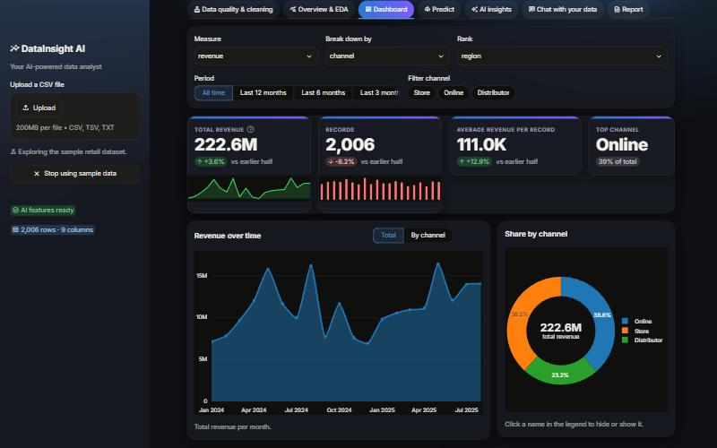
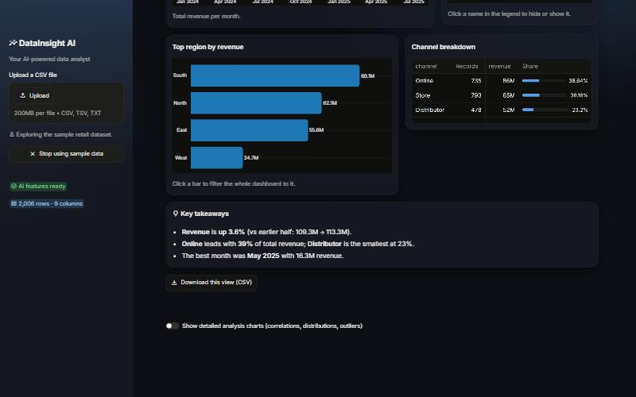
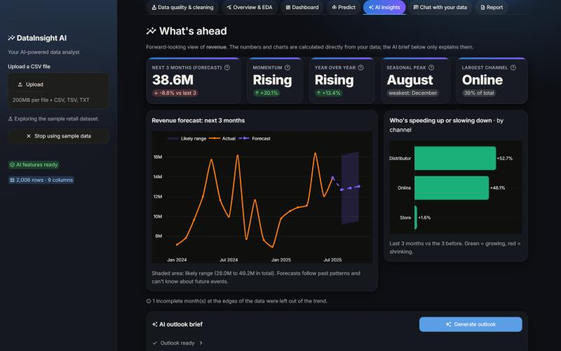
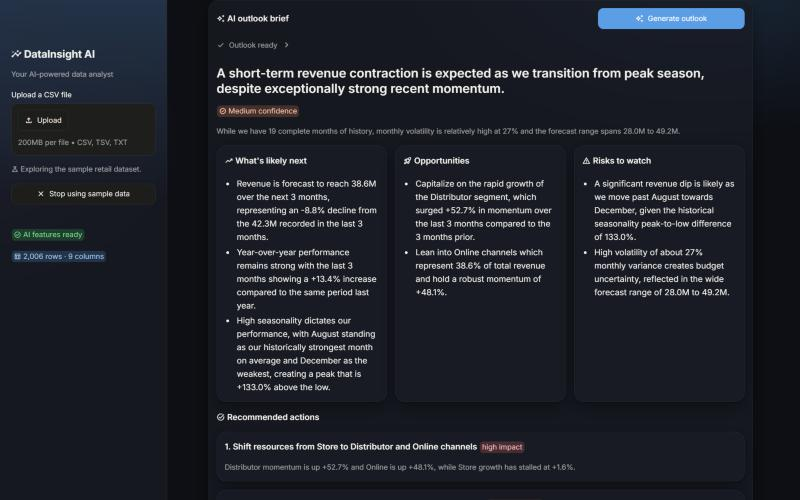
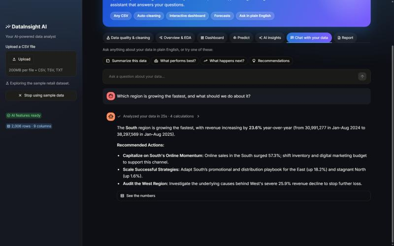
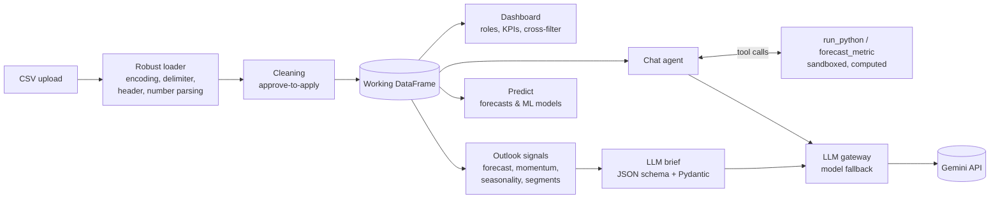

# DataInsight AI

**Your AI data analyst.** Upload any CSV and get a client-ready interactive dashboard, forecasts, a forward-looking AI brief, and a chat assistant that answers questions in plain English, with every number calculated from your data, never guessed.




---

## Why this project

Most "chat with your CSV" demos let a language model guess at numbers. DataInsight AI is built on one rule:

> **Code calculates. AI explains.**

Every total, forecast and percentage is computed with pandas, statsmodels and scikit-learn. The LLM is only used to *choose* calculations (as an agent calling tools) and to *explain* results in plain English. The answers you show a client are therefore exact and reproducible, and the AI can't invent figures.

## Features

| | What it does |
|---|---|
| 📥 **Loads messy real-world CSVs** | Auto-detects encoding (UTF-8, UTF-16, Excel's Windows-1252), separators (`,` `;` tab `\|`), title rows above the header and malformed rows, and converts `"₹ 1,20,000"`, `"$1,200.50"` or `"12%"` into numbers. It tells you every adjustment it made. |
| 🧹 **Data quality & cleaning** | Finds missing values, duplicates, outliers and inconsistent text, and proposes explained fixes. Nothing changes until you approve, every step is logged, and it can be undone. |
| 📊 **Client-ready dashboard** | Detects the date, the money/amount columns and the groupings automatically. KPI cards with sparklines and % change, trend chart, donut share chart, **click-a-bar cross-filtering**, breakdown table, computed *key takeaways*, and CSV export. |
| 🔮 **AI outlook (future insights)** | 3-month forecast with a likely range, momentum, year-over-year growth, seasonal peaks, rising/declining segments and concentration risk, plus an AI brief with opportunities, risks and 3 recommended actions. |
| 💬 **Chat with your data** | Ask *"Which region is growing fastest and what should we do?"* and get a direct answer with real numbers, charts on request, and no code. |
| 🤖 **Predict** | Forecast any metric, or train and compare ML models (Linear/Logistic Regression, Decision Tree, Random Forest, Gradient Boosting) with proper metrics, cross-validation and feature importance. |
| 📄 **Report** | Exports everything from the session as one self-contained HTML report. |
| 🧪 **Sample data** | One click on *Try with sample data* loads 2,000 retail orders, so you can explore every feature without your own file. |

## Screenshots

| Dashboard: breakdown & takeaways | AI outlook: forecast & momentum |
|---|---|
|  |  |

| AI outlook brief (structured output) | Chat: answers, not code |
|---|---|
|  |  |

## AI & ML techniques used

| Technique | Where | Why it matters |
|---|---|---|
| **LLM agent with tool calling** | `modules/chat_agent.py` | The model decides *which* calculation answers a question and calls a sandboxed `run_python` tool or a `forecast_metric` tool. The answer comes from real computation. |
| **Grounding / context engineering** | `chat_agent.build_dataset_context`, `outlook.signals_text` | Exact dataset facts and computed signals are given to the model up front, so simple questions need one call and every claim is traceable. |
| **Structured outputs** | `modules/outlook.py` | The outlook brief is requested as a JSON schema and validated with **Pydantic** (with a retry), so the UI renders reliable cards instead of parsing free text. |
| **Prompt engineering** | system prompts in `chat_agent.py`, `outlook.py` | Answer-first business language, "never invent numbers", honest confidence levels, no jargon. |
| **Model fallback & resilience** | `modules/llm.py` | One gateway for all LLM calls. When a model hits its free-tier daily quota it automatically switches to another, with cooldowns and friendly messages. |
| **AI safety guardrails** | `chat_agent._validate_code` | Model-written code is checked with an AST scan and run without imports or file, network or system access. The LLM never receives raw rows, only summaries. |
| **Time-series forecasting** | `modules/predict.py` | Holt's exponential smoothing (damped trend, seasonality when there's enough history) on properly aggregated periods, with incomplete edge periods removed and an uncertainty band. |
| **Classical ML** | `modules/predict.py` | Multi-model comparison, cross-validation, task-appropriate metrics, permutation importance. |

## AI fundamentals: what's used, and where the rest fits

| Concept | Status | In this project |
|---|---|---|
| Large language models (LLMs) | ✅ Used | Gemini powers the chat assistant, the outlook brief and the dataset summary |
| AI agents & tool calling | ✅ Used | The chat agent picks and runs calculation and forecast tools in a loop |
| Prompt & context engineering | ✅ Used | Versioned system prompts; exact dataset facts sent as grounding context |
| Structured outputs | ✅ Used | JSON schema + Pydantic validation for the outlook brief |
| Conversation memory | ✅ Used | Chat history is kept across turns, so follow-up questions work |
| Guardrails & responsible AI | ✅ Used | AST-checked sandbox for model-written code; raw rows never sent to the LLM; "never invent numbers" |
| LLM reliability | ✅ Used | Multi-model fallback on rate limits, timeouts and errors |
| Machine learning & forecasting | ✅ Used | scikit-learn model comparison, cross-validation, Holt forecasting |
| RAG (embeddings + vector search) | 🔜 Planned | Uploaded PDFs/reports would be chunked, embedded into a vector store (e.g. Chroma) and retrieved with citations next to the data |
| LangChain / LangGraph | 🔜 Planned | LangChain for the document pipeline; LangGraph to route each question to data analysis, document search or forecasting |
| LLM evaluation | 🔜 Planned | A test set scored for correctness and faithfulness (LLM-as-a-judge) |
| Observability | 🔜 Planned | Per-question token, cost and latency tracing |

The LLM calls go through one gateway (`modules/llm.py`), and the data tools are plain Python functions. So adding a retrieval tool or moving the agent loop to LangGraph changes the orchestration, not the analysis code.

## How it works



## Quick start

**Requirements:** Python 3.10+ and a free Gemini API key ([get one here](https://aistudio.google.com/apikey), no credit card needed). The app runs without a key too; only the AI brief and chat are disabled.

```bash
git clone https://github.com/rishithagona28/DataInsight-AI.git
cd DataInsight-AI
python -m venv venv
venv\Scripts\activate           # macOS/Linux: source venv/bin/activate
pip install -r requirements.txt
copy .env.example .env          # macOS/Linux: cp .env.example .env  (then add your key)
streamlit run app.py
```

Open http://localhost:8501 and click **Try with sample data**.

> **Windows one-click:** double-click `Launch DataInsight AI.vbs` to start the app in the background and open it in your browser, and `Stop DataInsight AI.vbs` to stop it. (These expect the virtual environment in a `venv` folder one level up from the project; adjust the path in the script if yours differs.)

### Configuration (`.env`)

| Variable | Purpose |
|---|---|
| `GEMINI_API_KEY` | Your key. Read server-side only and never sent to the browser. |
| `GEMINI_MODELS` | Optional comma-separated model order for automatic fallback. |
| `LLM_BASE_URL` | Optional. Any OpenAI-compatible endpoint (Groq, OpenRouter, a local Ollama) works without code changes. |

## Project structure

```
app.py                    # Streamlit UI: seven tabs wiring the modules together
modules/
  loader.py               # robust CSV loading (encoding, delimiter, header, number parsing)
  eda.py                  # profiling: column types, cardinality, outliers, quality report
  cleaning.py             # approval-gated cleaning recommendations
  dashboard.py            # client-ready dashboard: role detection, KPIs, cross-filtering, takeaways
  charts.py               # detailed analysis charts (correlations, distributions, outliers)
  predict.py              # forecasting (period aggregation + Holt) and ML model comparison
  outlook.py              # forward-looking signals + structured AI brief (Pydantic)
  chat_agent.py           # tool-calling chat agent with sandboxed code execution
  insights.py             # dataset health summary and model-comparison explanations
  llm.py                  # single LLM gateway with multi-model fallback
  report.py               # self-contained HTML report
  style.py                # theme-aware visual design (CSS) and hero banner
sample_data/
  make_sample.py          # generates the sample dataset (growth, seasonality, segment trends)
  retail_sales.csv
docs/screenshots/         # images used in this README
```

## Performance

Tested against a synthetic **300,000-row / 19 MB** CSV:
- Loading: clean files use pandas' fast C parser (about 0.7 s for 300K rows). The slower tolerant parser runs only when a file actually has malformed rows.
- Charts aggregate or sample server-side before rendering, so the detailed chart section sends under 200 KB to the browser at any data size, and one bad column can't crash a page.
- Model training samples above 50,000 rows, keeps high-cardinality columns out of one-hot encoding, and scales ensemble sizes. Full app render was under 10 s and the default prediction flow under 35 s.
- Profiling, quality reports, signals and model comparisons are cached, so revisiting a tab doesn't recompute.

## Limitations

- Forecasts follow past patterns (Holt's exponential smoothing) and can't anticipate future events. The shaded range is a rough guide, not a statistical confidence interval.
- Model comparisons use default hyperparameters and one train/test split: a fast first read, not production-tuned models.
- The code sandbox is a meaningful safeguard but not a full security boundary. Run the app for personal or local use, not for untrusted users.
- Gemini's free tier has daily request limits per model. The fallback chain stretches them, and enabling billing (very low cost for this usage) removes the limit.

## Roadmap

- [ ] **RAG with LangChain:** upload PDFs or reports and ask questions across documents *and* data, with citations
- [ ] **LangGraph agent:** route each question to data analysis, document search or forecasting, with conversation memory
- [ ] **Evaluation suite:** a question set scored for answer correctness and faithfulness (LLM-as-a-judge)
- [ ] **Observability:** token, cost and latency tracking per question
- [ ] **Deployment:** Docker image and a public demo link

## Author

**Rishitha Naga Durga Gona** · [@rishithagona28](https://github.com/rishithagona28)
